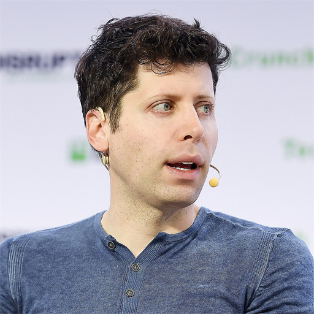

# Sam Altman

Игрушечная программа для Windows на C++: занимает почти всю свободную
оперативную и видеопамять, а по рабочему столу при этом летает портрет
Sam Altman — отскакивает от краёв экрана, как DVD-логотип на старых
телевизорах, и меняет цвет при каждом отскоке.



> **Дисклеймер.** Это шуточный проект, он не связан с Сэмом Альтманом,
> OpenAI, TechCrunch и Getty Images. Фотография используется как
> пародийный аватар и не означает одобрения с их стороны.
>
> `SamAltman.exe` не подписан цифровой подписью, поэтому SmartScreen
> может показать предупреждение — это обычное дело для самосборных
> программ. Антивирус тоже может коситься на программу, которая
> намеренно ест память.

---

## ⚠️ Важно, прочитайте перед запуском

Программа **намеренно** съедает память. Это не вирус и ничего не портит,
но ведёт себя как очень тяжёлая игра:

* она займёт всю свободную RAM, оставив ~1.5 ГБ, и всю свободную VRAM,
  оставив ~1 ГБ;
* система может начать тормозить, другие программы — подвисать;
* Windows может увеличить файл подкачки (нужно свободное место на диске);
* **сохраните работу в других программах перед запуском.**

Выход в любой момент:

| Клавиши | Действие |
|---|---|
| `Ctrl + Alt + Q` | выйти и освободить всю память |
| `Ctrl + Alt + F` | мгновенно освободить память и поставить заполнение на паузу (повторно — продолжить) |
| `Ctrl + Alt + H` | скрыть / показать летающего Sam |
| `Ctrl + C` в консоли | выход |

Если система всё-таки сильно зависла, помогает `Ctrl + Alt + Del` →
Диспетчер задач → снять `SamAltman.exe` (в крайнем случае — кнопка Reset).

---

## Что делает

1. **RAM.** В фоновом потоке выделяет и «материализует» блоки по 64 МБ,
   пока свободной физической памяти не останется ~1.5 ГБ. Пытается
   попросить Windows удерживать страницы в физической памяти
   (`SetProcessWorkingSetSizeEx`), чтобы они не уходили в подкачку.
2. **VRAM.** Через Direct3D 11 создаёт текстуры 4096×4096 (64 МБ каждая)
   и заполняет их нулями, пока бюджет видеопамяти процесса не подойдёт
   к ~1 ГБ свободного запаса.
3. **Рабочий стол.** Создаёт прозрачное «слоёное» окно поверх всех окон,
   рисует круглый портрет с ободком и двигает его по всему виртуальному
   рабочему столу (все мониторы), отражая от краёв и меняя оттенок.

Запас памяти настраивается — см. аргументы ниже.

---

## Запуск

Просто откройте `SamAltman.exe`. Откроется консоль со статистикой
(сколько занято, сколько свободно, FPS), а поверх рабочего стола
полетит Sam.

Если хочется сначала попробовать без риска:

```bat
SamAltman.exe --test
```

Режим `--test` занимает не больше 1 ГБ RAM и 512 МБ VRAM и сам
закрывается через 12 секунд.

### Аргументы

| Аргумент | Значение |
|---|---|
| `--ram-reserve=МБ` | сколько RAM оставить свободной (по умолчанию 1536) |
| `--vram-reserve=МБ` | сколько VRAM оставить свободной (по умолчанию 1024) |
| `--ram-cap=МБ` | максимум занятой RAM, 0 = без ограничения |
| `--vram-cap=МБ` | максимум занятой VRAM, 0 = без ограничения |
| `--no-ram` | не трогать оперативную память |
| `--no-vram` | не трогать видеопамять |
| `--no-overlay` | не показывать летающего Sam |
| `--size=ПИКСЕЛИ` | размер портрета, по умолчанию 220 |
| `--speed=ПИКС/СЕК` | скорость полёта, по умолчанию 280 |
| `--duration=СЕК` | выйти через N секунд (0 = до Ctrl+Alt+Q) |
| `--test` | безопасный тест: 2 ГБ RAM, 512 МБ VRAM, 12 секунд |
| `--help` | справка |

Примеры:

```bat
:: оставить 2 ГБ RAM и 1.5 ГБ VRAM
SamAltman.exe --ram-reserve=2048 --vram-reserve=1536

:: только летающий Sam, память не трогать
SamAltman.exe --no-ram --no-vram

:: крупнее и быстрее
SamAltman.exe --size=320 --speed=600
```

---

## Сборка из исходников

Нужен **MinGW-w64** (g++ + windres). В этой системе он уже стоит.

```powershell
powershell -ExecutionPolicy Bypass -File .\build.ps1
```

Скрипт сам:

1. собирает `tools/mkassets.cpp` и генерирует `assets/face.png` и
   `assets/icon.ico` из исходного фото;
2. компилирует ресурсы (`src/resource.rc`: иконка, портрет, манифест);
3. компилирует `src/main.cpp` и линкует `SamAltman.exe`.

Пересобрать начисто: `.\build.ps1 -Clean`.

Структура проекта:

```
sam-altman/
├─ SamAltman.exe        готовая программа
├─ README.md            описание
├─ LICENSE              MIT (код)
├─ ASSETS.md            лицензия на фото (CC BY 2.0)
├─ build.ps1            сборка (PowerShell)
├─ build.cmd            сборка в один клик
├─ assets/
│  ├─ face_src.jpg      исходное фото
│  ├─ face.png          портрет 512×512 (встроен в exe)
│  └─ icon.ico          иконка 16…256 px (встроена в exe)
├─ src/
│  ├─ main.cpp          вся программа
│  ├─ resource.rc       ресурсы
│  └─ app.manifest      DPI-awareness, совместимость с Win10/11
└─ tools/
   └─ mkassets.cpp      генератор face.png и icon.ico
```

---

## Как это устроено (коротко)

* **RAM:** `VirtualAlloc(MEM_COMMIT | MEM_RESERVE | MEM_TOP_DOWN)` +
  запись по одному байту на страницу, чтобы страницы реально заняли
  физическую память. Поток следит за `GlobalMemoryStatusEx` и
  останавливается у заданного резерва; при опасно низкой свободной
  памяти (меньше 256 МБ) аварийно отдаёт несколько блоков.
* **VRAM:** `D3D11CreateDevice` → `IDXGIAdapter3::QueryVideoMemoryInfo`
  (бюджет/занято) → текстуры `D3D11_USAGE_DEFAULT` с `UpdateSubresource`,
  чтобы драйвер не поленился выделить память.
* **Портрет:** окно `WS_EX_LAYERED | WS_EX_TRANSPARENT | WS_EX_TOPMOST |
  WS_EX_TOOLWINDOW`, отрисовка GDI+ в 32-битный DIB с премультиплицированной
  альфой, показ через `UpdateLayeredWindow`. Координаты — в физических
  пикселях (Per-Monitor V2), границы — весь виртуальный рабочий стол.

---

## Атрибуция фотографии

Портрет: **Steve Jennings / TechCrunch**, 2019, лицензия
[CC BY 2.0](https://creativecommons.org/licenses/by/2.0/), источник —
[Wikimedia Commons: Sam Altman CropEdit James Tamim.jpg](https://commons.wikimedia.org/wiki/File:Sam_Altman_CropEdit_James_Tamim.jpg)
(кроп — James Tamim).

В программе фотография уменьшена, обрезана по кругу и тонируется —
изменения внесены. Фото используется только как шуточный аватар.

## Лицензии

* **Код** — MIT, см. [LICENSE](LICENSE).
* **Фотография** — CC BY 2.0 (атрибуция выше); лицензия MIT на неё
  не распространяется, подробности в [ASSETS.md](ASSETS.md).
* Проект не связан с Сэмом Альтманом, OpenAI, TechCrunch и Getty Images.
